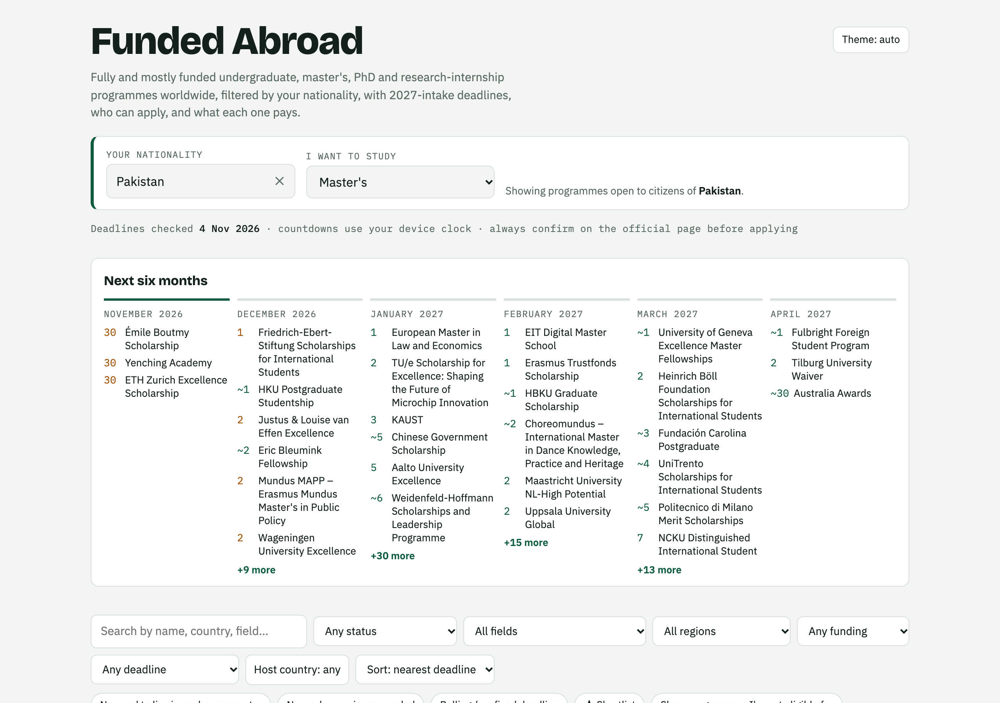
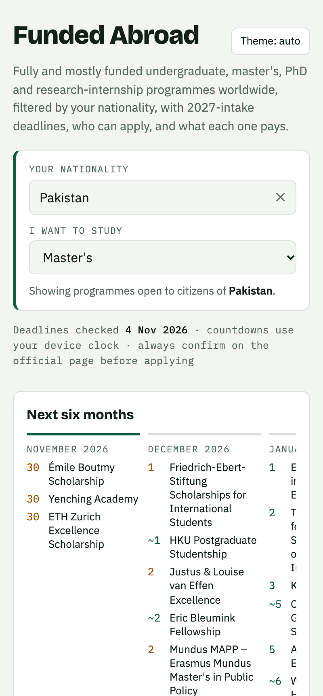

# Funded Abroad

*Find the funded scholarships you can actually apply for, filtered by your nationality and study level.*

**Live site: https://funded-abroad.pages.dev**

[](https://github.com/AbdulMominAlam/funded-abroad/actions/workflows/ci.yml)
[](https://funded-abroad.pages.dev)

A free, global scholarship finder. Pick your **nationality** and **study level** and you'll see only the fully or mostly funded undergraduate, master's, PhD and research-internship programmes you can actually apply for. Each one shows a live deadline countdown, who can apply, what it pays, and a link to the official page. **Email alerts** (weekly digest and shortlist reminders) are built but not switched on yet; see [Email alerts](#email-alerts-how-they-work).

[](https://funded-abroad.pages.dev/#nat=PK&lvl=masters)

<p align="center"></p>

## Highlights

- **561 funded programmes** in 64 host countries and territories, plus multi-country and global programmes
- **Nationality-aware eligibility** for 243 countries and territories
- **Level picker:** undergraduate, master's, PhD or internships
- **Deadline countdowns** and a six-month deadline strip
- **Shortlist, checklists, compare**, `.ics` calendar export, and export/import of your data
- **Free static hosting** with zero running cost

* **561 programmes**: 135 undergraduate, 211 master's, 203 PhD and 125 internships / summer research (some cover several levels). See [CHANGES.md](CHANGES.md) for sources, estimates and what's least certain.
* 243 nationalities (ISO 3166 codes). Eligibility rules are data, not code: "all nationalities", "only these countries", "everyone except…", named groups (Commonwealth, EU/EEA, ASEAN, African Union, OIC), or "check the official list".
* A static site that runs free on Cloudflare Pages (or GitHub Pages). The only server-side part is the optional email alerts, which use free tiers of Supabase, Resend and GitHub Actions.

**To deploy your own copy and turn on alerts, follow [SETUP.md](SETUP.md)** (step by step, beginner-friendly).

## Tech stack

- **Site:** [Vite](https://vite.dev/) + TypeScript (vanilla, no framework), built to static files
- **Tests:** [Vitest](https://vitest.dev/)
- **CI:** GitHub Actions ([ci.yml](.github/workflows/ci.yml))
- **Hosting:** Cloudflare Pages
- **Optional email alerts:** [Supabase](https://supabase.com/) (Postgres + Edge Functions), [Resend](https://resend.com/) for sending, and a scheduled GitHub Action ([alerts.yml](.github/workflows/alerts.yml)) for the daily job

## What's on the page

- **Nationality + level pickers** at the top. They're searchable, remembered in your browser, and included in shareable links (`#nat=PK&lvl=masters`). Programmes you can't apply for are hidden; **Show programmes I'm not eligible for** shows them greyed out with the reason.
- **Next six months**: a deadline strip for your nationality and level.
- **Filters**: search, status, field, region, **host country** (multi-select), **funding type** (fully funded / partial / salaried / paid internship), **deadline within 30/60/90 days**, sort, *no need to live in my home country*, *no work experience needed*, *rolling / no fixed deadline*, *★ shortlist*. A stats line shows "Showing X of Y matching · Z programmes you can apply for", and results load 30 at a time (**Show more**).
- **Cards** with:
  - status and countdown ("No fixed date" for rolling programmes)
  - deadline in the programme's own time zone
  - amount and requirement tags
  - nomination and residency flags
  - notes specific to your nationality (e.g. "Apply on the HEC portal as well" for Pakistan)
  - which official page the entry was checked against
  - an application checklist
  - Add to calendar (.ics with 14- and 3-day reminders) and Compare
- **Tools**: export your shortlist to a calendar, export/import your data (JSON), copy a link to the current view.
- **Get deadline alerts**: email, nationality, level, weekly digest weekday, and shortlist reminders. Double opt-in, with one-click unsubscribe that deletes your data. On the live site this panel currently shows "Alerts coming soon" (see [Email alerts](#email-alerts-how-they-work)).
- **[Privacy page](privacy.html)**: what's stored and how to delete it.

## Run it locally

Needs Node.js 20.19+ (22 recommended).

```bash
npm install
```

```bash
npm run dev
```

| Command | What it does |
| --- | --- |
| `npm run validate-data` | Checks every file in `src/data/programmes/` plus `countries.json` and `country-groups.json` (duplicate ids and duplicate name+host across files too); fails loudly on bad data |
| `npm run validate-data -- src/data/programmes/phd/b12-europe.json` | Validates just that file (still checks its ids against all others) |
| `npm run list-programmes` | Prints every programme (id, name, host, levels, file); handy to avoid duplicates |
| `npm test` | Vitest: status/countdown, eligibility (every rule type + groups), migration, filters, URL hash, .ics, checklists, import/export, validator, and the alert system (planning, dedupe, tokens, handlers, templates; Supabase/Resend mocked, no network) |
| `npm run build` | Validate + type-check + build the static site into `dist/` (`index.html` and `privacy.html`) |
| `npm run preview` | Serve `dist/` locally |
| `npm run alerts:sample` | Dry run of the alert job for a made-up subscriber; needs no accounts |
| `npm run alerts -- --dry-run` | Dry run against your real Supabase subscribers (needs env vars, see SETUP.md) |

Optional env vars for the site are in `.env.example` (`VITE_SUPABASE_URL`, `VITE_SUPABASE_ANON_KEY`).

## Project layout

```
index.html, privacy.html       pages (Vite entries)
src/
  main.ts                      wiring: state, events, rendering
  types.ts                     Scholarship, Eligibility, levels, regions, fields
  eligibility.ts               who can apply (shared by the site and the alert job)
  status.ts                    open / closing soon / upcoming / expected / varies / rolling / closed
  filters.ts                   filtering, sorting, URL hash
  storage.ts                   all localStorage access (try/catch)
  checklist.ts, ics.ts, backup.ts, validate.ts
  alerts/plan.ts               which alert emails each subscriber gets today (pure, tested)
  ui/                          cards, deadline strip, compare table, alerts panel
  data/programmes/<level>/*.json  ← programme data, many small files merged at build time
  data/countries.json          ← nationalities (generated by scripts/gen-countries.ts)
  data/country-groups.json     ← named groups of countries
supabase/
  migrations/*.sql             tables + Row Level Security
  functions/subscribe|confirm|unsubscribe/index.ts   Edge Functions (Deno entry points)
  functions/_shared/           handlers, email sender (Resend), templates, REST store (also used by the job)
scripts/
  validate-data.ts, gen-countries.ts, list-programmes.ts, lib/programmes.ts (Node loader)
  alerts/send-alerts.ts        the daily alert job
  migrate-v3.py, add-v3-programmes.py   one-off data migrations (kept for review)
.github/workflows/ci.yml       validate, test, build, alert smoke test, Deno type-check
.github/workflows/alerts.yml   daily alerts (cron) + manual dry run
```

## Add or update a programme

Programme data is split into small files under `src/data/programmes/<level>/` (e.g. `phd/b12-europe.json`). Add an entry to the file that fits best (or create a new `.json` file containing an array). Every file is picked up automatically. Then run `npm run validate-data`. The brief used for research is in [docs/research-brief.md](docs/research-brief.md). Example:

```json
{
  "id": "commonwealth-shared",
  "name": "Commonwealth Shared Scholarships",
  "host": "Commonwealth Scholarship Commission + UK universities",
  "country": "United Kingdom",
  "region": "uk",
  "levels": ["Master's"],
  "full": true,
  "amount": "Tuition, living allowance, flights (check official page)",
  "opens": "2026-11-10",
  "deadline": "2026-12-08T16:00:00+00:00",
  "dlText": "10 Nov – 8 Dec 2026, 16:00 GMT",
  "tags": ["2:1 degree"],
  "eligibility": { "type": "list", "countries": ["BD", "GH", "IN", "KE", "NG", "PK"] },
  "residencyRequired": true,
  "work": false,
  "nominationBody": null,
  "countryNotes": { "PK": "Example: a note only Pakistani visitors see." },
  "fields": "Development-relevant one-year master's",
  "fieldCats": ["any"],
  "note": "About 180 awards for 2027/28.",
  "url": "https://cscuk.fcdo.gov.uk/scholarships/commonwealth-shared-scholarships-applications/",
  "source": "https://cscuk.fcdo.gov.uk/scholarships/commonwealth-shared-scholarships-applications/",
  "verifiedOn": "2026-11-04"
}
```

(The country list and `countryNotes` are shortened examples; see the real entry in the data file.)

| Field | Required | Notes |
| --- | --- | --- |
| `id` | yes | Unique; lowercase letters, digits, hyphens. Used in shortlists, backups and alert subscriptions: don't rename. |
| `levels` | yes | Any of `"Undergraduate"`, `"Master's"`, `"PhD"`, `"Internship"`. The level picker has separate *PhD* and *Internships* options. |
| `eligibility` | yes | `{"type":"all"}` · `{"type":"list","countries":[…]}` · `{"type":"exclude","countries":[…]}` · `{"type":"group","group":"commonwealth"}` (only when the official source defines eligibility that way) · `{"type":"check","note":"…"}` when the official country list is long or changes yearly. Codes are ISO 3166-1 alpha-2 (`XK` = Kosovo). |
| `residencyRequired` | yes | `true` if you must live in your home country when applying. |
| `work` | yes | `true` if work experience is required. |
| `nominationBody` | yes | Who must nominate you (`"Your national nominating agency (e.g. HEC in Pakistan)"`, `"Your university"`), or `null`. |
| `countryNotes` | no | Nationality-specific notes, keyed by country code. Shown only to that nationality. |
| `deadline` | yes* | ISO 8601 **with a time zone** (`-12:00` = Anywhere on Earth). *Leave it out only with `"rolling": true`. |
| `opens` | no | `YYYY-MM-DD` or ISO date-time. If it's in the future, the card says "Opens …". |
| `expected` / `varies` / `rolling` | no | Estimated from the last cycle / depends on course or country (`deadline` is then representative) / no single date. |
| `nextText` | no | Shown once closed, e.g. "Next round ~Aug 2027". |
| `amount` | yes | Never guess: write "check official page" if unknown. |
| `region`, `fields`, `fieldCats` | yes | Region: `europe`, `uk`, `east-asia` (East & Southeast Asia), `middle-east`, `north-america`, `oceania`, `turkiye`, `global`. Field categories: `cs-ai`, `engineering`, `sciences`, `social`, `any`. |
| `url`, `source`, `verifiedOn` | yes | Official page, the official page you checked, and the date (`YYYY-MM-DD`). |
| `tags`, `note`, `dlText`, `name`, `host`, `country`, `full` | yes | Display text and flags. `country` also feeds the host-country filter. |
| `funding` | no | `full`, `partial`, `salaried` (paid job, e.g. European PhD positions) or `paid-internship`. Defaults to full/partial from `full`. |
| `checklist` | no | Extra checklist items for this programme. |

The validator rejects unknown fields, bad country codes or group names, deadlines without a time zone, impossible dates, non-https URLs, duplicate ids, and `opens` dates after the deadline.

To add a country group, add it to `src/data/country-groups.json` with `name`, an official `source` URL and `countries`.

## Email alerts: how they work

> **Status: built, tested, but not switched on yet.** The live site shows "Alerts coming soon" until the Supabase, Resend and GitHub Actions steps in [SETUP.md](SETUP.md#3-create-the-supabase-project-and-database) (steps 3–7) are done. Everything below describes how it works once they are.

```
Site panel ──POST──▶ Supabase Edge Function `subscribe` ──▶ subscribers (unconfirmed) ──▶ Resend: "Confirm your alerts"
Email link ──GET──▶ `confirm` ──▶ confirmed (+ optional "New subscriber: <country>, <level>" to ADMIN_EMAIL)
GitHub Actions (daily) ──▶ scripts/alerts/send-alerts.ts ──▶ weekly digest (chosen weekday, UTC) + 14/3-day shortlist reminders
                                                       └──▶ sent_notifications (never the same email twice)
Every email ──▶ one-click `unsubscribe` (deletes the subscriber and their history; also RFC 8058 List-Unsubscribe)
```

* **Security:** Row Level Security is on and the public key has no table privileges. Only the functions and the job use the service-role key. Sign-ups are rate-limited (per hashed IP and per hashed email), have a honeypot field, and never reveal whether an address is already subscribed. If a confirmed subscriber signs up again, their settings only change after they confirm by email.
* **Swappable email:** `EmailSender` in `supabase/functions/_shared/types.ts`. `ResendSender` is the only implementation; write another class to switch provider.
* **Secrets** (never committed): site `VITE_SUPABASE_URL`, `VITE_SUPABASE_ANON_KEY`; server `SUPABASE_URL`, `SUPABASE_SERVICE_ROLE_KEY`, `RESEND_API_KEY`, `ADMIN_EMAIL`, `NOTIFY_ADMIN_ON_CONFIRM`, `SITE_URL`, `EMAIL_FROM`, `HASH_SALT`. See `.env.example` and SETUP.md.

## Deploy

The site is live on **Cloudflare Pages** at **https://funded-abroad.pages.dev** and redeploys automatically on every push to `main` (other branches get preview URLs).

* **Cloudflare Pages (current host; free; works with private repos).** Settings:

  | Setting | Value |
  | --- | --- |
  | Production branch | `main` |
  | Build command | `npm run build` |
  | Build output directory | `dist` |
  | Environment variable | `NODE_VERSION=22` (+ the two `VITE_` variables once alerts are switched on) |

  `public/_headers` adds security headers. Details in [SETUP.md](SETUP.md#2-put-the-website-online-cloudflare-pages).
* **GitHub Pages (alternative):** the build uses a relative `base`, so `dist/` works from any sub-path. Enable Pages (Source: GitHub Actions) and uncomment the `deploy` job in `.github/workflows/ci.yml`. GitHub Pages needs a **public** repo; for a private repo it needs a paid plan (Pro, Team or Enterprise).
* **Anything else static:** upload `dist/`.

## CI

`.github/workflows/ci.yml` runs on every push and pull request:
1. `npm run validate-data`
2. `npm test`
3. `npm run build`
4. the alert job's sample dry run
5. a Deno type-check of the Edge Functions

`.github/workflows/alerts.yml` sends alerts daily (and can be run by hand as a dry run). Until its secrets are added it just prints "not configured" and succeeds.

## Privacy and accuracy

Shortlists, checklists and settings stay in your browser unless you sign up for alerts. This is an unofficial guide: deadlines and rules change, so always confirm on the official page linked on every card. See [CHANGES.md](CHANGES.md) for what was verified and how.

## About

Built by **Abdul Momin** ([@AbdulMominAlam](https://github.com/AbdulMominAlam) · [portfolio](https://abdulmominalam.github.io)), a computer science student at Sabancı University. Development was assisted by [Claude Code](https://claude.com/claude-code).

> **Disclaimer:** scholarship details change often. Always confirm deadlines, eligibility and funding on the official page before applying.
